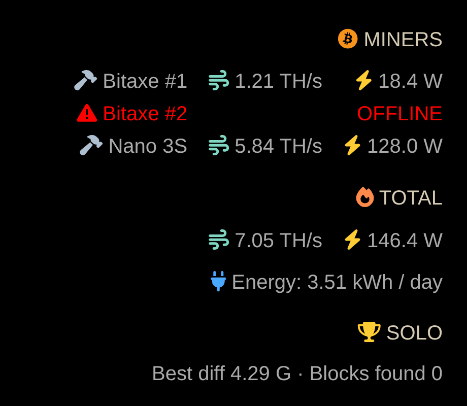

# MMM-MinerStats

Shows the hash rate and power of your home miners on [MagicMirror²](https://magicmirror.builders/), with totals and the energy they use per day. A miner that stops answering turns red.



Works with any mix of:

- **Bitaxe** and other miners running AxeOS (`bitaxe`)
- **Avalon Nano 3S** (`avalon-nano`)

## Install

It has no dependencies, so there is nothing to `npm install`. It needs Node 18 or newer.

```sh
cd ~/MagicMirror/modules
git clone https://github.com/roman-mueller-ch/MMM-MinerStats
```

### 1. List your miners

Your miners go in a private file outside the MagicMirror folder:

```sh
mkdir -p ~/.config/MMM-MinerStats
cp ~/MagicMirror/modules/MMM-MinerStats/miners.example.json ~/.config/MMM-MinerStats/miners.json
chmod 600 ~/.config/MMM-MinerStats/miners.json
```

Then edit it. The module rereads it on every update, so changes need no restart.

```json
{
	"miners": [
		{ "name": "Bitaxe", "type": "bitaxe", "host": "192.168.1.50" },
		{ "name": "Nano 3S", "type": "avalon-nano", "host": "192.168.1.51" }
	]
}
```

| Field | What it is |
| --- | --- |
| `name` | The label on the mirror. |
| `type` | `bitaxe` or `avalon-nano`. |
| `host` | The miner's IP address or hostname. |

No passwords are needed. The module reads a Bitaxe over HTTP and an Avalon Nano through its CGMiner API on TCP port 4028, so the mirror must be able to reach those.

### 2. Add the module

Add it to `config/config.js`:

```js
{
	module: "MMM-MinerStats",
	position: "bottom_right",
	config: {
		updateInterval: 30000
	}
}
```

## Options

| Option | Default | What it does |
| --- | --- | --- |
| `updateInterval` | `30000` | Milliseconds between updates, at least 5000. |
| `title` | `"MINERS"` | The heading above the list. |
| `showTemperature` | `false` | Adds a temperature column. |
| `showEnergy` | `true` | Shows the energy line. |

The energy line assumes today's power draw continues for 24 hours, so it is an estimate.

## Privacy

MagicMirror serves both `/config` and `/modules` over HTTP, so anyone who can reach your mirror could download files from them. That is why your miners' addresses go in `~/.config/MMM-MinerStats/miners.json` instead.

Only the module's Node helper reads that file. The browser gets each miner's name and readings, and never its address, wallet or pool details.

The module only sends read requests, but your miners' APIs have no login, so anyone on your network can reach them too. Keep your miners on a network you trust.

## Tests

```sh
npm test
```

To redraw `docs/demo.png` with made-up readings, run `tools/screenshot.sh`. It needs Chromium, or set `CHROME` to your browser's path, and it loads the icon font from a CDN.
